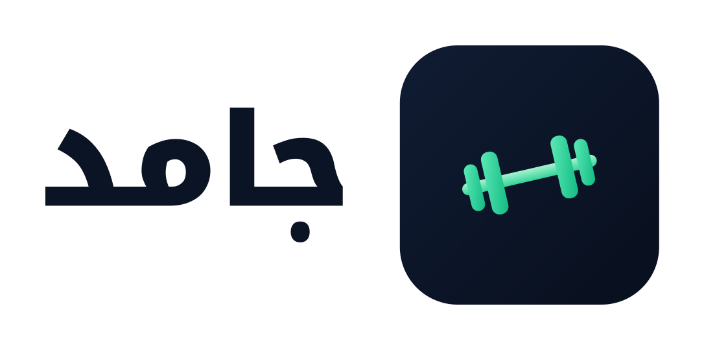
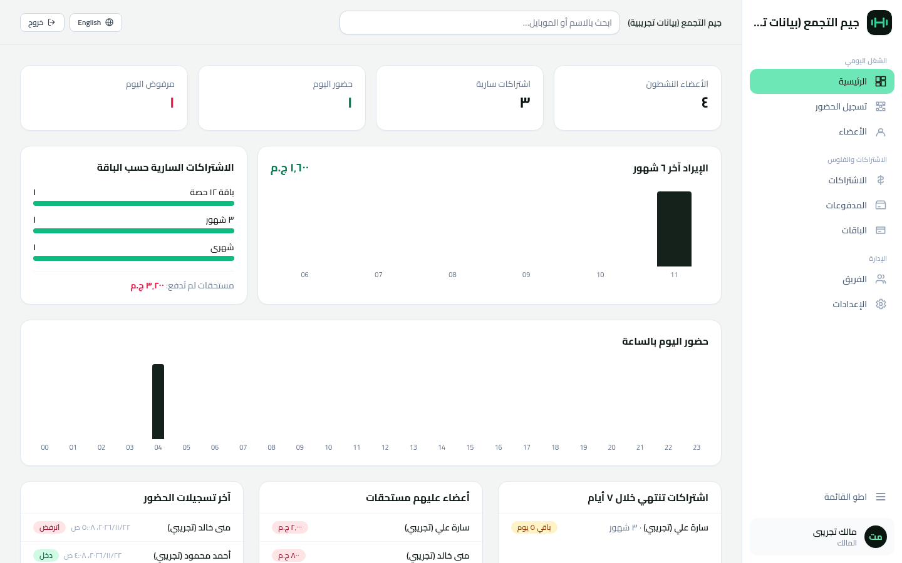

<p align="center">
  
</p>

<p align="center">
  <strong>جامد — Gamed</strong><br>
  Gym management for Arabic-first gyms: members, subscriptions, QR check-in, classes, payments — and a read-only Claude connector.
</p>

<p align="center">
  
  
  
  
</p>

<p align="center">
  <a href="#what-this-is">What this is</a> ·
  <a href="#the-claude-connector">Claude connector</a> ·
  <a href="#stack">Stack</a> ·
  <a href="#quick-start">Quick start</a> ·
  <a href="#configuration">Configuration</a> ·
  <a href="#demo-data">Demo data</a>
</p>

---

## What this is

Gamed is a multi-tenant gym management system built for independent gyms in Egypt and the Gulf. The reception desk is the home screen: who is active, whose subscription ends this week, who owes money, and who just scanned in.

It is bilingual from the first commit — full Arabic RTL and English interfaces, per-user locale, Arabic-first print and member cards — not a translation layer bolted on afterwards.

| | |
| --- | --- |
| **Members** | Cards with QR codes, search by name or phone, branches, notes |
| **Subscriptions** | Duration and session-pack plans, freezes that extend the end date, renewals that chain cleanly, partial payments and per-member balances |
| **Check-in** | QR scan or member number, accept/deny with the reason, session deduction on packs, debt shown as a warning — never a door lock |
| **Classes** | Weekly schedule, capacity, waitlists, booking per member |
| **Money** | Manual payment records (cash / card / wallet / transfer), debtor lists, revenue reports by month, plan and method |
| **Team** | Owner and receptionist roles; branch-pinned staff see only their own branch |
| **Leads** | Walk-in leads with follow-up tracking and one-tap conversion to members |
| **Tenancy** | Every row is scoped to its gym and covered by isolation tests |

Billing for gyms themselves is manual by design at this stage: a gym signs up, requests a plan, and the platform owner activates it after payment. Nothing is charged automatically.

## Screenshots

<p align="center">
  
</p>

## The Claude connector

Gyms can connect their own Claude account (Settings → Connectors → Add custom connector) and ask questions in plain Arabic: revenue so far this month, whose subscription ends this week, today's check-ins, the biggest debtors.

The connector is **read-only and consent-based**:

- An MCP endpoint (`/mcp`) plus OAuth 2.1 with PKCE (S256), dynamic client registration and rotating refresh tokens.
- The gym owner — and only the owner — approves the connection on an explicit consent page that shows the app, the redirect host, the account and the gym. Staff cannot approve.
- Eight read tools (`gym_stats`, `search_members`, `get_member`, `expiring_subscriptions`, `list_debtors`, `today_checkins`, `revenue_summary`, `today_classes`). There is no write tool; there is nothing to call one with.
- Every token call re-checks eligibility: if the connector is switched off, the gym is suspended, or the owner's role is removed, the token stops working.
- Each gym's data is isolated by a global tenant scope; a token minted for one gym cannot see another gym's rows, and the test suite proves it.
- Reusing an authorization code or a rotated refresh token revokes the whole connection family. The owner can also disconnect any app from Settings at any time.

The connector is off by default (`ai_enabled`) and answers are sent to the third-party AI app under the user's own account terms with it.

## Stack

| | |
| --- | --- |
| **Framework** | Laravel 13, PHP 8.3 |
| **UI** | Inertia.js + Vue 3, Tailwind CSS 4, Cairo font |
| **i18n** | Arabic (default) and English, RTL/LTR, per-user locale |
| **Data** | MySQL / MariaDB in production, SQLite for tests and local dev |
| **Auth & roles** | Laravel auth + email verification, spatie/laravel-permission |
| **Tests** | Pest, 100 feature tests including tenant isolation and the OAuth/MCP flow |

### Layout

| Path | |
| --- | --- |
| `app/Models` | Tenant-scoped models; `BelongsToGym` enforces isolation on every query |
| `app/Http/Controllers` | Desk features plus `OauthController` and `McpController` for the AI connector |
| `app/Console/Commands` | `gym:demo` (synthetic demo data) and subscription expiry |
| `resources/js/Pages` | Inertia pages, Arabic-first, per-user locale |
| `resources/js/lib/i18n.js` | The full AR/EN string table |
| `database/migrations` | Additive, migrate-only schema history |
| `tests/Feature` | Feature tests: tenancy, billing lockout, classes, OAuth/MCP |

### Rules the codebase holds to

- **Every tenant row passes one scope.** `BelongsToGym` filters each query by the signed-in gym and fills `gym_id` on create; the isolation tests try to cross gyms on purpose.
- **Money is records, not gateways.** Payments are manual desk records with partial amounts and balances; no card is ever charged.
- **New gyms start locked.** Without platform activation a fresh gym sees only the billing page.

## Quick start

You need PHP 8.3+, Composer and Node 20+.

```sh
git clone https://github.com/SalemAshraf/leyaqa-gym.git && cd leyaqa-gym
cp .env.example .env            # defaults are local + SQLite
composer install
npm install

php artisan key:generate
touch database/database.sqlite
php artisan migrate
php artisan gym:demo            # optional: one isolated demo gym with synthetic data

npm run build                   # or: npm run dev
php artisan serve
```

The app is on [localhost:8000](http://localhost:8000). Run the tests with `php artisan test`.

## Configuration

Everything beyond the defaults is optional; [`.env.example`](./.env.example) has the full list.

| | |
| --- | --- |
| `APP_LOCALE` | Default interface language: `ar` or `en`. |
| `DB_CONNECTION` | `sqlite` locally; `mysql` with the usual `DB_*` keys in production. |
| `PLATFORM_ADMIN_EMAILS` | Comma-separated emails allowed into the platform admin area. Unset means no platform admins — the safe direction to fail. |
| `PLATFORM_TRIAL_DAYS` | If set, new gyms start as `trialing`; if unset, they stay `pending` until the platform owner activates them. |
| `PLATFORM_GRACE_DAYS` | Grace period after an expired platform subscription before lockout. |
| `PLATFORM_SALES_WHATSAPP` | Sales contact shown on billing pages, international format without `+`. |

New platform plans are managed from the platform admin area, not the environment.

## Demo data

`php artisan gym:demo` creates **one** demo gym ("جيم التجمع — بيانات تجريبية") with two logins (owner and reception) and a synthetic dataset: ~50 members, plans, subscriptions in every state, partial payments and debtors, classes, and two weeks of check-ins. All names, phones and payments are fictional.

- It is additive and refuses to run if the demo accounts already exist — it never touches existing data.
- It asks for the demo password on a hidden prompt; leave it empty and it generates one and prints it once.
- In production it additionally requires `--force`.

## Deployment notes

Run migrations on deploy (`php artisan migrate --force`), schedule `php artisan schedule:run` every minute (subscription expiry), and build assets with `npm run build`. The demo command, seeds and `.env` are never part of a production upload.

## License

No license has been selected yet; default copyright applies. The owner will choose one before any reuse is permitted.
